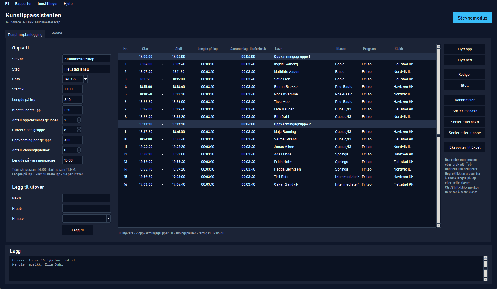
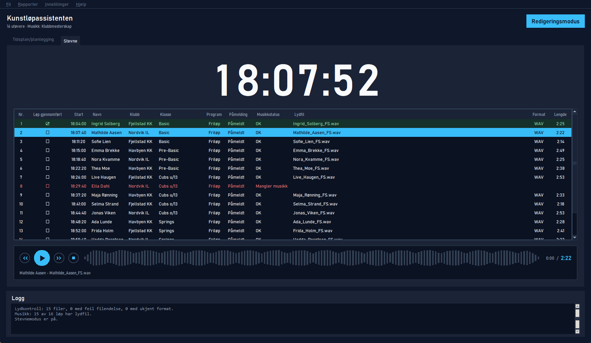

# Kunstløpassistenten

Et program for å lage tidsplan og startliste til kunstløpstevner, og for å spille musikken under stevnet.

## Last ned

**[⬇ Last ned Kunstlopassistenten.zip](https://github.com/Jollymix/KunstlopFikser/releases/latest/download/Kunstlopassistenten.zip)** (for Windows, ca. 40 MB)

Du trenger ikke installere noe annet.

1. Klikk på lenken over. Filen havner i mappen **Nedlastinger**.
2. Høyreklikk på `Kunstlopassistenten.zip` og velg **Pakk ut alle…**, så **Pakk ut**.
   Ikke start programmet direkte fra zip-filen, da virker det ikke.
3. Åpne mappen `Kunstlopassistenten` som kom ut, og dobbeltklikk på **Kunstlopassistenten.exe**.

**Kommer det en blå boks med «Windows beskyttet PCen»?** Det er vanlig for små programmer som ikke er kjøpt i en butikk. Klikk **Mer info** og så **Kjør likevel**. Dette må du bare gjøre første gang.

**Vil du ha programmet på en USB-pinne?** Kopier hele mappen `Kunstlopassistenten` (ikke bare .exe-filen) over til pinnen. Da kan du starte det fra pinnen på hvilken som helst Windows-PC.

## Hva programmet gjør

- **Tidsplan/planlegging**: Hent deltakerlisten fra isonen, eller legg inn utøvere selv for mindre stevner. Sett starttid, lengde på løp, klart til neste løp, oppvarming og vanningspauser. Dra rader med musen, så oppdateres tidene med en gang. Oppsettet lagres i en egen fil, og startlisten eksporteres til Excel og PDF.
- **Stevne**: Stor klokke, musikk fra musikktjenesten som spilles av i programmet eller i VLC, og avkrysning av løp som er gjennomført.

Til et stevne trengs tre filer (eller velg «Skann mappe» på mappen der de ligger):

- `Deltakerliste*.xlsx` fra isonen.
- `entries_*.xlsx`, deltakerlisten fra musikktjenesten. Kobles til isonen med NIF ID (= Person ID).
- `Music*.zip` fra musikktjenesten, med lydfiler per klasse og program (`SP`/`FS`) og `music-status.csv`.

Utøvere med kortprogram og friløp får ett løp for hvert program.

## For utviklere

Start fra kildekoden med `start_kunstlopassistenten.bat` (krever Python og `pip install -r requirements.txt`).

Ny nedlastbar versjon lages automatisk når en versjonstagg pushes: `git tag v1.1; git push --tags`. For å bygge lokalt: `powershell -ExecutionPolicy Bypass -File build_usb.ps1`, resultatet havner i `dist\Kunstlopassistenten`.
